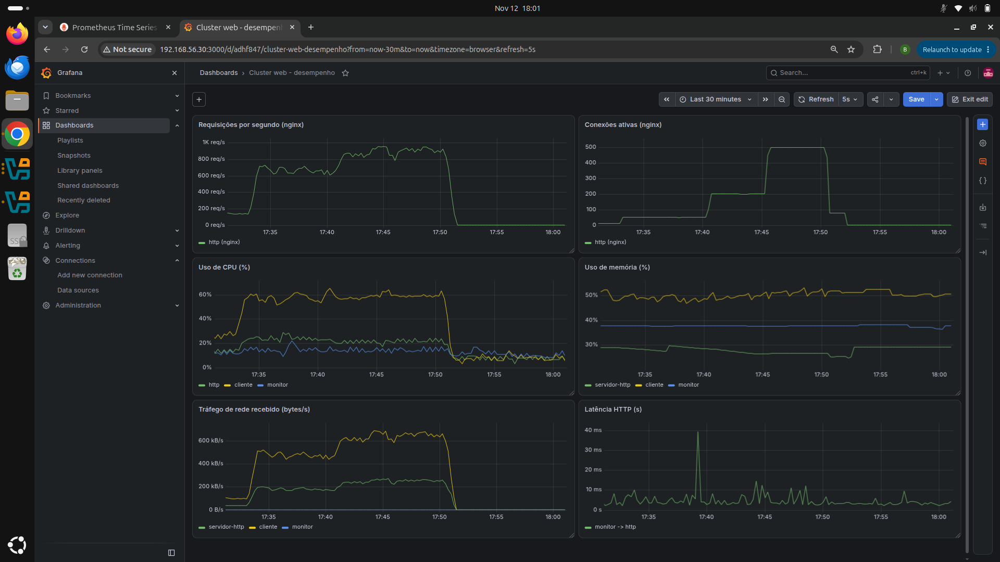
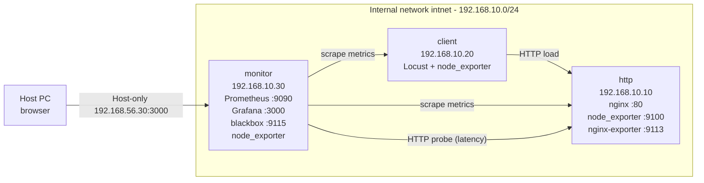
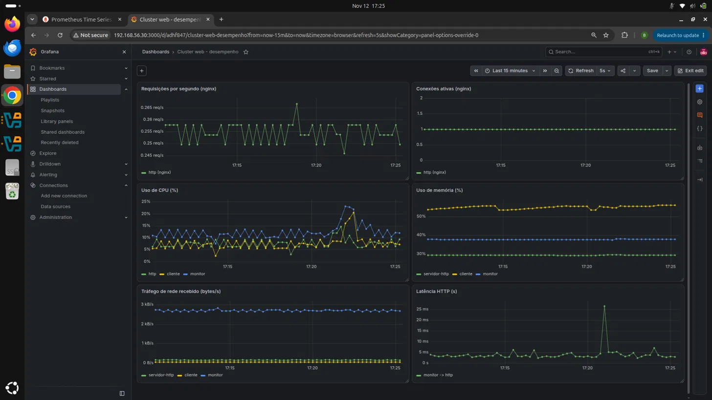
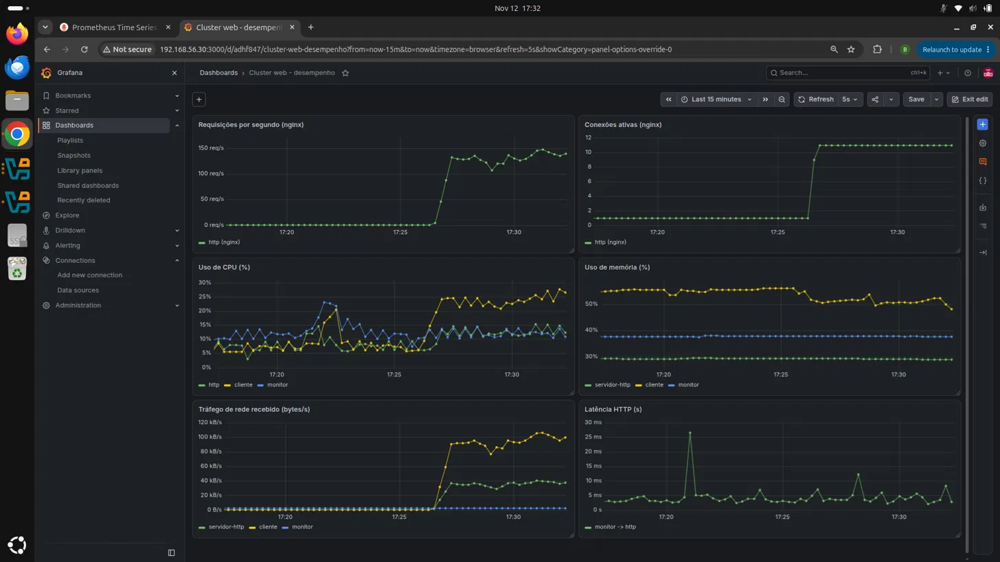
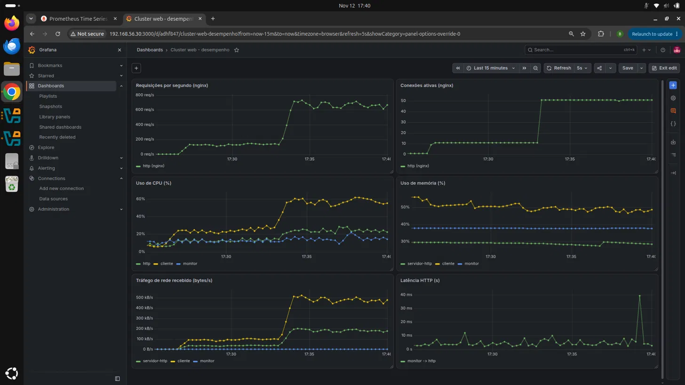
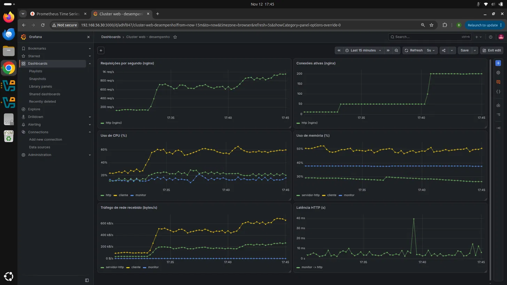
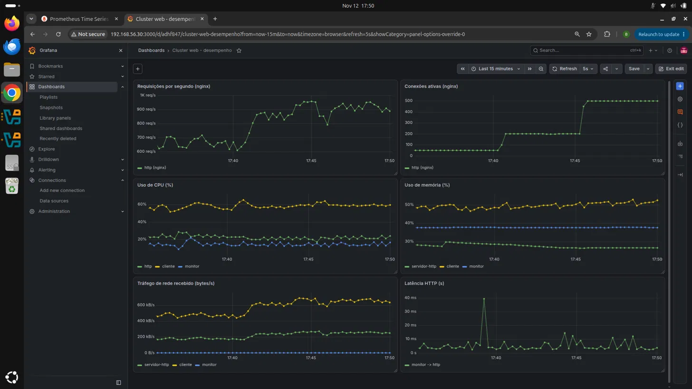
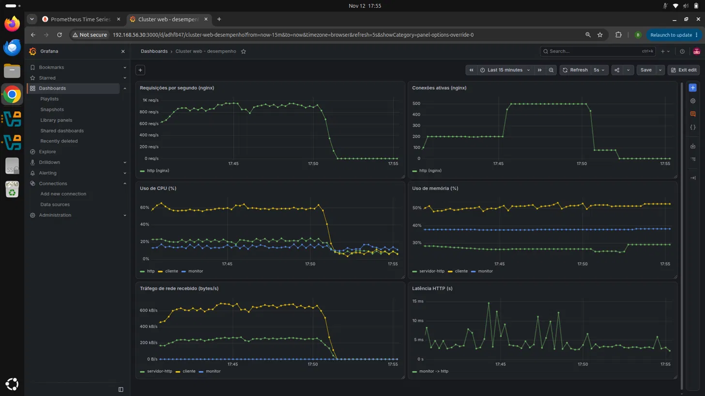
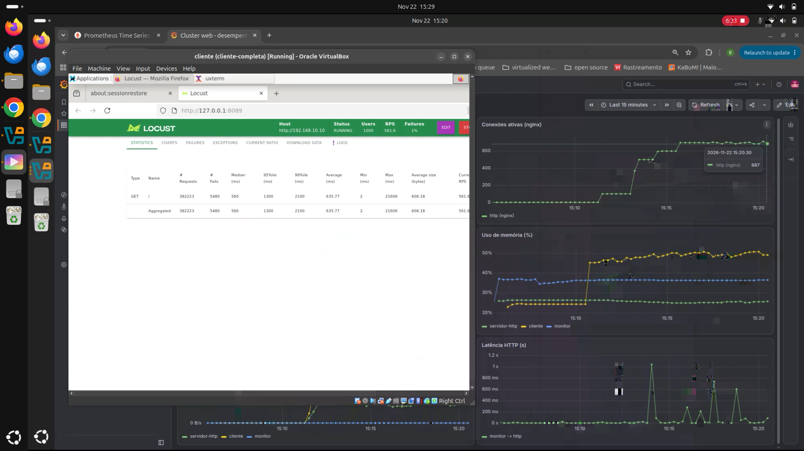

# Virtualized Web Cluster with Performance Monitoring

A three-VM lab on VirtualBox that hosts a small web service, generates HTTP load against it and shows, in Grafana dashboards, how CPU, memory, network, requests and latency react as the load grows.

University project for the *Computer Organization and Operating Systems* course (UNIFACS, 2026.2), Topic 6: *Virtualization: web cluster with performance monitoring*.



> Videos: [load ramp-up (sped up)](https://youtu.be/6nHhd1B0uyg) · [1000-user stress test](https://youtu.be/kNAIzMezB70) · Slides: [Canva](https://canva.link/uimvg814snwknye)

## Assignment

Topic 6 asks for a cluster of VMs hosting a simple web service (HTTP server + a client that sends requests) with monitoring that collects performance metrics from the VMs. Minimum requirements:

- 1 monitoring tool, 1 HTTP server and 1 request client.
- Generate load from the client and show its impact on the metrics.
- Grafana dashboards for CPU, memory, network and latency/requests.
- Deliver screenshots of the dashboards showing the behavior under load.

## Architecture



| VM | Role | Resources (during the recorded tests) | IP |
|---|---|---|---|
| `http` | Web server | 1 vCPU, 1 GB RAM | 192.168.10.10 |
| `client` | Load generator (Locust, with Xfce desktop for its web UI) | 2 vCPUs, 2 GB RAM | 192.168.10.20 |
| `monitor` | Prometheus, Grafana, Blackbox Exporter | 1 vCPU, 2 GB RAM | 192.168.10.30 / 192.168.56.30 |

Every VM has a NAT adapter (package installs) and the internal network `intnet`; only `monitor` has a third, host-only adapter so Grafana can be opened from the host. More detail in [docs/architecture.md](docs/architecture.md).

## Stack

| Component | Version | Runs on |
|---|---|---|
| VirtualBox | 7.2.22 | Host (Ubuntu 26.04) |
| Debian | 13 (trixie) | All VMs |
| nginx | 1.26.3 | `http` |
| Locust | 2.47.0 (Python 3.13.5) | `client` |
| Prometheus | 2.53.3 | `monitor` |
| Grafana | 13.3.0 | `monitor` |
| Node Exporter | 1.9.0 | All VMs |
| Nginx Prometheus Exporter | 1.4.1 | `http` |
| Blackbox Exporter | 0.26.0 | `monitor` |

Host: Intel Celeron laptop with 20 GB of RAM.

## What is monitored

The Grafana dashboard *Cluster web - desempenho* ([grafana/](grafana/)) has six panels:

| Panel | Source | Query (PromQL) |
|---|---|---|
| Requests per second | nginx exporter | `rate(nginx_http_requests_total[1m])` |
| Active connections | nginx exporter | `nginx_connections_active` |
| CPU (%) | node_exporter | `100 - (avg by (instance) (rate(node_cpu_seconds_total{mode="idle"}[1m])) * 100)` |
| Memory (%) | node_exporter | `(1 - (node_memory_MemAvailable_bytes / node_memory_MemTotal_bytes)) * 100` |
| Network received | node_exporter | `rate(node_network_receive_bytes_total{device="enp0s8"}[1m])` |
| HTTP latency | blackbox_exporter | `probe_duration_seconds{job="blackbox-http"}` |

Latency comes from the Blackbox Exporter (an HTTP probe from `monitor` to `http` every 5 s), not from Locust. This gives an independent measurement of what a third party sees while the client is loading the server.

## How to reproduce

The step-by-step guide is in [docs/installation-guide.md](docs/installation-guide.md). In short:

1. Create three Debian 13 VMs and set up the networks as described above.
2. `http`: install nginx, node_exporter and the nginx exporter; enable `stub_status` on localhost only ([configs/http/](configs/http/)).
3. `monitor`: install Prometheus, Blackbox Exporter and Grafana; use [configs/monitor/prometheus.yml](configs/monitor/prometheus.yml); import the dashboard from [grafana/](grafana/).
4. `client`: create a Python venv, install Locust and run it with [configs/client/locustfile.py](configs/client/locustfile.py).

## Load test

The number of users was changed from the Locust web UI, with the same `locustfile.py` (each user does `GET /` and waits 0 to 0.1 s).

| Phase | Users | Spawn rate (users/s) |
|---|---|---|
| Idle | 0 | - |
| Load 1 | 10 | 2 |
| Load 2 | 50 | 5 |
| Load 3 | 200 | 50 |
| Load 4 | 500 | 50 |
| Recovery | 0 (stop) | - |
| Stress | 1000 | 100 |

## Results

Approximate values read from the Grafana charts and the Locust UI.

| Users | Req/s | Active connections | CPU `client` | CPU `http` | Latency (Blackbox) |
|---|---|---|---|---|---|
| 0 (idle) | ~0.25 | 1 | ~7% | ~7% | 3-5 ms |
| 10 | 130-150 | ~11 | ~25% | ~12% | 3-5 ms |
| 50 | 650-700 | ~51 | 55-60% | 22-25% | 3-5 ms |
| 200 | 850-1000 | ~200 | ~60% | ~22% | 3-5 ms |
| 500 | 900-1000 | 500 | ~60% | ~22% | 3-5 ms (isolated spikes of 25-40 ms) |
| 1000 | 600-800 | ~700 | 60-80% | 30-45% | spikes of ~1 s; ~1.4% failures |

| Idle | 10 users | 50 users |
|---|---|---|
|  |  |  |

| 200 users | 500 users | Recovery |
|---|---|---|
|  |  |  |

Stress test with 1000 users (Locust UI):



### Analysis

- **Throughput scaled up to ~50 users.** Requests per second, connections, network traffic and CPU rose together.
- **Throughput flattened at about 1,000 req/s.** From 200 to 500 users the active connections kept growing (200, 500) while requests per second barely changed.
- **The bottleneck was the load generator, not nginx.** Client CPU stayed around 60% (Locust is a single Python process per core) while the `http` VM stayed near 22%.
- **Latency did not react to load** up to 500 users: an nginx serving a static page was far from its limit, so the probe latency stayed at 3-5 ms. The isolated spikes do not follow the load steps.
- **Memory was stable**, as expected for a static page.
- **Idle traffic (~0.25 req/s) is the monitoring itself:** the Blackbox probe every 5 s (0.2 req/s) plus the nginx exporter reading `stub_status` every 15 s (~0.07 req/s). The single active connection is that `stub_status` read.
- **Stress test (1000 users).** Locust reported 382,223 requests, 5,480 failures (~1.43%), average response time 636 ms, p95 1,300 ms, p99 2,100 ms. In Grafana, active connections stalled around 700 (below the 1000 users) and the probe latency reached ~1 s. nginx was ruled out as the limit: `worker_connections` is the default 768 and the error log has no *"worker_connections are not enough"* entries. The client VM has a file-descriptor limit of 1024 (`ulimit -n`), which is consistent with the ~700-connection ceiling, together with the client CPU at 60-80%. This is the most likely explanation, not a proven one; it was not re-tested with a higher `ulimit`.

### Limitations

- Everything runs on one laptop (Intel Celeron), so the three VMs compete for the same hardware.
- A single Python process generates the load, which caps throughput before nginx is stressed.
- Each phase was run once; there are no repeated runs for averages or deviation.
- Values were read from charts, so they are approximate.

### Future work

- Raise the client's open-file limit, or run Locust distributed, and repeat the 1000-user test.
- Use a more efficient load generator (such as `wrk`) to actually stress nginx.
- Give the `http` VM more vCPUs and tune `worker_processes` / `worker_connections`.
- Serve dynamic content (an app with a database) to see latency grow.
- Add a second nginx and a load balancer to form a real cluster.
- Repeat each phase several times and report mean and standard deviation; add Prometheus alerts.

## Repository structure

```
.
├── README.md
├── configs/
│   ├── http/        status.conf, prometheus-nginx-exporter, interfaces
│   ├── client/      locustfile.py, interfaces
│   └── monitor/     prometheus.yml, interfaces
├── grafana/         cluster-web-desempenho.json
├── docs/
│   ├── installation-guide.md
│   ├── architecture.md
│   ├── ai-usage.md
│   └── report-pt-BR.pdf     (group report, in Portuguese)
└── media/           dashboard screenshots and diagram
```

## Documentation

- [Installation and configuration guide](docs/installation-guide.md)
- [Architecture](docs/architecture.md)
- [Group report (Portuguese)](docs/report-pt-BR.pdf)
- [AI assistance](docs/ai-usage.md)
- [Slides (PDF)](docs/slides.pdf) · [Canva](https://canva.link/uimvg814snwknye)

## Authors

- Alexandre Mascarenhas
- [Bruno Gomes](https://github.com/brunocmg)
- Bruno Gama
- Cauã Praxedes
- Silas Rocha.

## Notes

- The IPs are private and exist only inside the lab.
- Grafana uses the default `admin` login only inside the isolated lab; change the password for any real use.
- nginx `stub_status` listens on `127.0.0.1` only, and the exporter reads it locally.
- This project used an LLM as a guide; see [docs/ai-usage.md](docs/ai-usage.md).