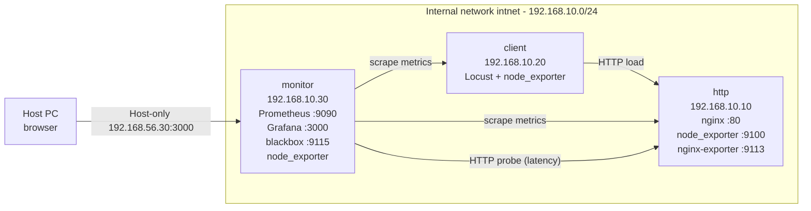

# Architecture

## Overview

Three Debian 13 virtual machines run on one host under VirtualBox. Each VM has a single role, so the process that generates the load never shares a machine with the process that serves it or the one that measures it.

## Virtual machines

| VM | Role | Resources (recorded tests) | Services |
|---|---|---|---|
| `http` | Web server | 1 vCPU, 1 GB RAM | nginx (:80), node_exporter (:9100), nginx exporter (:9113) |
| `client` | Load generator | 2 vCPUs, 2 GB RAM, Xfce | Locust (UI on :8089, local only), node_exporter (:9100) |
| `monitor` | Monitoring | 1 vCPU, 2 GB RAM | Prometheus (:9090), Grafana (:3000), Blackbox Exporter (:9115), node_exporter (:9100) |

Host: Ubuntu 26.04, VirtualBox 7.2.22, Intel Celeron, 20 GB RAM.

## Networks

| Network | Interface | Used for |
|---|---|---|
| NAT | `enp0s3` | Internet access to install packages |
| Internal `intnet` (192.168.10.0/24) | `enp0s8` | All experiment traffic: load from `client` to `http` and metric collection by `monitor` |
| Host-only (192.168.56.0/24) | `enp0s9`, on `monitor` only | Opening Grafana from the host at `192.168.56.30:3000` |

Keeping the experiment on `intnet` isolates it from the internet and from the host.

## Data flow

1. Locust on `client` sends HTTP `GET /` requests to nginx on `http`.
2. nginx answers. The nginx exporter reads nginx's `stub_status` (served on `127.0.0.1:8080` only) and publishes service metrics on :9113; node_exporter publishes system metrics on :9100.
3. Prometheus on `monitor` scrapes those endpoints, plus node_exporter on `client` and on itself.
4. The Blackbox Exporter, on `monitor`, probes `http://192.168.10.10` and records how long each request takes.
5. Grafana queries Prometheus and draws the six panels.

## Prometheus jobs

| Job | Target | Interval |
|---|---|---|
| `prometheus` | localhost:9090 | 5 s |
| `node` | localhost:9100 | 15 s |
| `servidor-http` | 192.168.10.10:9100 | 15 s |
| `cliente` | 192.168.10.20:9100 | 15 s |
| `nginx` | 192.168.10.10:9113 | 15 s |
| `blackbox-http` | `http://192.168.10.10` via the Blackbox Exporter at 127.0.0.1:9115, module `http_2xx` | 5 s |

The global interval is 15 s. Full file: [`../configs/monitor/prometheus.yml`](../configs/monitor/prometheus.yml).

## Operating-system view

Each VM is an independent Debian installation with its own kernel, processes and network interfaces; for the host it is just a VirtualBox process. The metrics shown in the dashboard come straight from the operating system of each VM:

- **CPU:** node_exporter reads per-mode CPU time from the kernel (`/proc/stat`); the panel shows 100 minus idle time. On `http`, nginx runs a master process and one worker; on `client`, Locust is one Python process that runs all virtual users.
- **Memory:** total and available memory from `/proc/meminfo`; the panel shows the percentage in use.
- **Network:** byte counters of each interface; the panel shows the receive rate on `enp0s8`.
- **Services:** nginx, Prometheus, Grafana and the exporters run as systemd services that start with the VM. Locust is started by hand during tests.
- **Limits:** the OS also sets limits that show up in the tests, such as the maximum number of open files per process (`ulimit -n`, 1024 by default), which is the likely cause of the connection ceiling seen in the 1000-user test.

## Design decisions

- **Latency from Blackbox Exporter, not Locust.** The nginx exporter does not expose response times, and Locust measures latency from the client side, including its own queueing. An HTTP probe from `monitor` is independent of the load generator.
- **`stub_status` on localhost only.** It exposes internal counters, so it is not reachable from the network; the exporter reads it locally.
- **Locust in a Python venv, started manually.** It keeps the system Python clean and lets the number of users be changed live from the web UI.
- **Separate VMs per role.** It makes each component's resource use visible and comparable in the dashboard.
- **Two scrape intervals.** 15 s is enough for resource metrics; 5 s on the latency probe and on Prometheus itself gives finer detail where it matters.